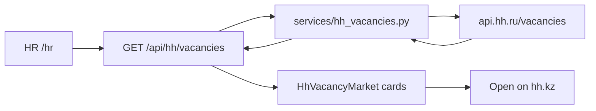

# HeadHunter HR vacancy market watch

Live hh.kz vacancies in **Управление персоналом, тренинги** on the HR home page. Seekers keep the existing local board. No OAuth, no import into `Company`/`Vacancy`, no apply-through-us.



## Non-goals

- Do not change [`backend/routers/jobs.py`](backend/routers/jobs.py) or seeker [`/jobs`](frontend/app/pages/jobs.vue)
- Do not persist HH rows, mix them into local vacancies, or apply from Resume AI
- Do not register a HeadHunter OAuth app or add `httpx` / `requests` (stdlib `urllib.request` only)
- Do not add Alembic, pagination on `/api/jobs`, or pytest

## HeadHunter contract

Public search (no token): `GET https://api.hh.ru/vacancies`

- **Area:** `40` (Kazakhstan) so `alternate_url` points at hh.kz
- **Roles:** category 12 — `17`, `38`, `69`, `117`, `118`, `153`, `171`, `181` (repeat `professional_role`)
- **Headers:** `User-Agent` / `HH-User-Agent` are required; HH returns 400 without them
- **Paging:** `page` (0-based), `per_page` (default 20, max 100)
- **Order:** `publication_time`
- Strip `<highlighttext>` from snippets before returning
- Timeout ~10s; HH down / non-200 → HTTP **503** (not `AI_ALLOW_FALLBACK`)

Env **names** only in [`.env.example`](.env.example) and [`backend/config.py`](backend/config.py):

- `HH_API_BASE` default `https://api.hh.ru`
- `HH_USER_AGENT` default `ResumeAI/1.3.0 (dev)`
- `HH_AREA` default `40`
- `HH_PER_PAGE` default `20`

## Backend

Thin router + service (same pattern as rank/export):

- New [`backend/services/hh_vacancies.py`](backend/services/hh_vacancies.py) — build query, call HH, map JSON → DTO, `HhUnavailable` on failure
- New [`backend/routers/hh.py`](backend/routers/hh.py) — `GET /api/hh/vacancies?page=` with `Depends(require_hr)` (seeker → **403**)
- Mount in [`backend/main.py`](backend/main.py)
- Schemas in [`backend/schemas.py`](backend/schemas.py) (mirror in Zod):

```python
class HhVacancyOut(BaseModel):
    id: str
    title: str
    employer_name: str
    area_name: str | None = None
    salary_from: int | None = None
    salary_to: int | None = None
    salary_currency: str | None = None
    published_at: str
    requirement: str | None = None
    responsibility: str | None = None
    experience: str | None = None
    schedule: str | None = None
    url: str  # HH alternate_url

class HhVacancyList(BaseModel):
    found: int
    page: int
    pages: int
    per_page: int
    items: list[HhVacancyOut]
```

Do not dump raw HH payloads to the SPA.

## Frontend

Stay inside [`frontend/app/features/hr/`](frontend/app/features/hr/): pages → features → shared. HTTP only in `*.api.ts`.

- Zod in new [`frontend/app/shared/schemas/hh.ts`](frontend/app/shared/schemas/hh.ts); re-export from [`index.ts`](frontend/app/shared/schemas/index.ts)
- [`frontend/app/features/hr/hh.api.ts`](frontend/app/features/hr/hh.api.ts) — `listHhVacancies(page)` → `apiRequest('/api/hh/vacancies')` + Zod parse
- `useHhVacancies` with `useAsyncData('hh-hr-vacancies')` (watch page)
- `HhVacancyMarket.vue`: loading / error+retry / empty / list matching existing HR cards; salary line; **Open on hh.kz** (`target="_blank"` `rel="noopener noreferrer"`); prev/next; source line that the list comes from hh.kz
- Mount on [`frontend/app/pages/hr/index.vue`](frontend/app/pages/hr/index.vue) between `HrHome` and `DashboardView`
- Export from [`frontend/app/features/hr/index.ts`](frontend/app/features/hr/index.ts)
- Same keys in [`kk.json`](frontend/i18n/locales/kk.json), [`ru.json`](frontend/i18n/locales/ru.json), [`en.json`](frontend/i18n/locales/en.json): `hh_title`, `hh_subtitle`, `hh_loading`, `hh_empty`, `hh_error`, `hh_open`, `hh_source`, `hh_salary`, `hh_found`, `hh_prev`, `hh_next`
- Vitest: parse a sample `HhVacancyList` in [`frontend/tests/schemas.spec.ts`](frontend/tests/schemas.spec.ts)

One `<h1>` stays on `HrHome`. The market block uses `<h2>`.

## Docs

Add the endpoint to the API table in [`ARCHITECTURE.md`](ARCHITECTURE.md) (Bearer HR, 503 if HH is down). Mention `HH_*` names in [`BUILD.md`](BUILD.md) env list.

## Verify

From `frontend/`: `pnpm lint`, `pnpm typecheck`, `pnpm test`.

In the browser (HR session): `/hr` loading, list, empty/error, prev/next, external link. Seeker must not see the feed; `GET /api/hh/vacancies` as seeker is 403. Local `/jobs` still only local vacancies.
