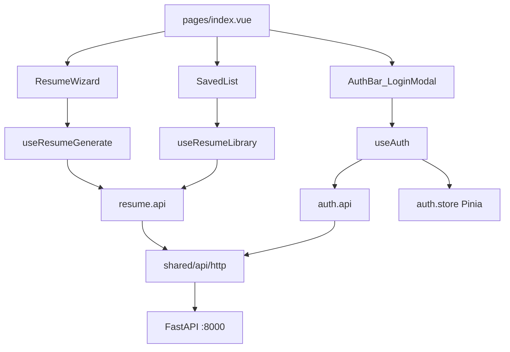

# Nuxt Frontend Migration

## Decisions (locked)

- **UI**: `@nuxt/ui` (v3) + Tailwind design tokens; thin wrappers only where needed
- **Location**: replace [`frontend/`](frontend/) with the Nuxt app root (not repo root)
- **Backend**: keep FastAPI in [`backend/`](backend/); stop mounting static files; CORS allow Nuxt origin (`http://localhost:3000`)
- **Auth**: keep JWT in cookie/`localStorage` via Pinia (same Bearer flow as today); no HttpOnly cookie migration in this pass
- **Rendering**: SPA for the app shell (`ssr: false` on `/` and authenticated flows); marketing not in scope

## Target layout (under `frontend/`)

```
frontend/
├── app/
│   ├── app.vue
│   ├── error.vue
│   ├── assets/css/main.css
│   ├── components/ui/          # optional thin Nuxt UI wrappers if needed
│   ├── composables/            # useToast helpers, etc.
│   ├── layouts/default.vue
│   ├── middleware/auth.ts
│   ├── pages/index.vue         # thin: compose wizard + sidebar
│   ├── features/
│   │   ├── auth/               # LoginModal, useAuth, auth.api, auth.store, schemas
│   │   ├── resume/             # wizard, form, experience, generate, analysis, export
│   │   ├── library/            # saved list, open/delete
│   │   └── i18n/               # locale messages + useLocale (or @nuxtjs/i18n)
│   ├── shared/api/http.ts      # $fetch.create + Bearer + AppError
│   └── shared/{utils,types,constants}/
├── nuxt.config.ts
├── package.json
├── tsconfig.json
├── .env.example                # NUXT_PUBLIC_API_BASE only
└── ARCHITECTURE.md
```

Dependency rule: `pages → features → shared`. Features export only via `index.ts`.

## Feature map (from current vanilla app)

| Current (`app.js` / HTML) | Nuxt home |
|---|---|
| Auth modal, token, `/me` | `features/auth` |
| 4-step wizard + progress | `features/resume` (`ResumeWizard`, `useResumeWizard`) |
| Experience add/remove | `features/resume` (`ExperienceList`) |
| Generate + analyze + preview | `features/resume` (`useResumeGenerate`, `AnalysisPanel`) |
| Export PDF/DOCX blob | `features/resume` (`useResumeExport`) |
| Saved list open/delete | `features/library` |
| KK/RU/EN strings | `@nuxtjs/i18n` (locales from current `I18N` object) |
| `api()` helper | `shared/api/http.ts` |

API contracts stay as in [`backend/schemas.py`](backend/schemas.py) — Zod schemas mirror Pydantic models at the boundary.

## Data flow



- Form state: local `reactive` + Zod (`resume.schema.ts`)
- Session user + token: Pinia `useAuthStore` (persisted token key `resume_ai_token` for continuity)
- Server lists (saved resumes): composable + `useAsyncData` with stable key, refresh after generate/delete

## Scaffold and config

1. Scaffold Nuxt 4 in `frontend/` (pnpm): TypeScript, `@nuxt/ui`, `@pinia/nuxt`, `@nuxtjs/i18n`, Zod
2. [`nuxt.config.ts`](frontend/nuxt.config.ts):
   - `runtimeConfig.public.apiBase` ← `NUXT_PUBLIC_API_BASE` (default `http://127.0.0.1:8000`)
   - `routeRules: { '/**': { ssr: false } }` for authenticated SPA
   - Modules: `@nuxt/ui`, `@pinia/nuxt`, `@nuxtjs/i18n`
3. Theme: port dark slate + sky accent from [`frontend/styles.css`](frontend/styles.css) into Nuxt UI / Tailwind CSS variables (no purple defaults)
4. Backend tweak in [`backend/main.py`](backend/main.py): remove `StaticFiles` mount of `../frontend`; set CORS origins to include `http://localhost:3000` (and keep `*` only if still needed for docs — prefer explicit origins)
5. Document env names in `frontend/.env.example` (no secrets); extend root [`.env.example`](.env.example) note for frontend if useful

## Page / UI composition

- **`layouts/default.vue`**: header (logo, nav anchors, lang switch, auth bar)
- **`pages/index.vue`**: sidebar (steps + `SavedList`) + `ResumeWizard` + auth hint; `definePageMeta` + `useSeoMeta`
- **Wizard steps** as panels (same UX): personal → experience → skills → preview/analysis/export
- **Auth**: `UModal` + form with Zod; gate generate/export via `useAuth` (open modal on 401)
- Fix known bug: do **not** port the duplicated Auth/Saved blocks in `app.js` (~519–709)

## Quality bar (senior-frontend skill)

- Strict TS, `<script setup lang="ts">`, no `any`
- Components dumb; logic in composables; no `$fetch` in components
- Loading / empty / error UI for generate, library, auth
- A11y: labeled inputs, modal focus, keyboard steps
- Scripts: `lint`, `typecheck` (`nuxt typecheck`), `test` (Vitest smoke for schemas + auth store)
- `ARCHITECTURE.md` summarizing this structure
- Leave Playwright/Husky for a follow-up unless time allows a minimal Vitest suite only in this pass

## Migration / cutover

1. Move current vanilla files aside briefly only if needed for reference (`frontend/_legacy/` optional) — prefer reading then deleting once Nuxt parity is verified
2. Dev: `uvicorn` on `:8000` + `pnpm dev` on `:3000`
3. Verify: register/login, 4-step form, generate, analysis metrics, saved open/delete, PDF/DOCX download, KK/RU/EN
4. Remove vanilla `index.html` / `app.js` / `styles.css` when parity confirmed

## Out of scope (this migration)

- HttpOnly cookie / Nitro BFF auth proxy
- Uploading existing resume files
- Full e2e Playwright CI / Husky / Conventional Commits tooling
- Redesigning IA beyond current single-page wizard
